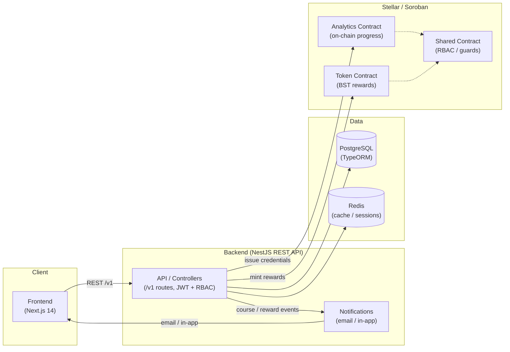

# scoopdope ..... good luck ...
y

[](./stryker.conf.js)

> A blockchain education platform built on the **Stellar network**, delivering verifiable on-chain credentials and token-based learning incentives.

---

## Overview

scoopdope is a full-stack, monorepo education platform that leverages the Stellar blockchain to issue tamper-proof credentials when learners complete courses. It is a rebranded and extended fork of the StrellerMinds project by [StarkMindsHQ](https://github.com/StarkMindsHQ), adapted for a broader scoopdope and vocational training audience.

The platform combines a modern web frontend, a scalable REST API backend, and a suite of Soroban smart contracts — all living in a single monorepo for streamlined development and deployment.

## Architecture

The diagram below shows how the main components of scoopdope interact: the frontend, the REST API, the PostgreSQL database, the Stellar/Soroban blockchain layer, and the notification subsystem.



**Component responsibilities:**

| Component | Role |
|---|---|
| Frontend | Next.js 14 app; wallet integration and learner UI |
| API | NestJS REST API exposing `/v1` routes with JWT auth and role guards |
| Database | PostgreSQL via TypeORM for users, courses, and enrollments |
| Blockchain | Soroban contracts on Stellar for credentials, progress, and token rewards |
| Notifications | Emits email / in-app notifications on course and reward events |

> Full diagram with data-flow annotations: [`docs/architecture.md`](./docs/architecture.md)

---

## Monorepo Structure

```
scoopdope/
├── apps/
│   ├── frontend/          # Next.js 14 web application (TypeScript)
│   └── backend/           # NestJS REST API (TypeScript)
├── contracts/
│   ├── analytics/         # On-chain progress tracking (Rust/Soroban)
│   ├── token/             # Reward token contract (Rust/Soroban)
│   └── shared/            # RBAC & shared utilities (Rust/Soroban)
├── scripts/               # Build and deploy scripts
├── docs/                  # Extended documentation
│   ├── production-deployment-guide.md # Production deployment & mainnet guide
│   ├── api-error-codes.md # API numeric error codes reference
│   ├── api-versioning.md
│   ├── api-rate-limiting.md
│   ├── community-moderation.md
│   ├── catastrophic-recovery.md
│   ├── kyc-verification.md
│   └── contract-abi.md    # Soroban contract ABI reference
├── .github/workflows/     # CI/CD pipelines
├── Cargo.toml             # Rust workspace
├── package.json           # Node.js workspace root
└── .env.example           # Environment variable template
```

---

## Tech Stack

### Frontend (`apps/frontend`)
| Technology | Purpose |
|---|---|
| Next.js 14 (App Router) | React framework with SSR/SSG |
| TypeScript | Type safety |
| Tailwind CSS | Utility-first styling |
| Zustand | Lightweight state management |
| Axios | HTTP client |
| @stellar/stellar-sdk | Stellar wallet integration |

### Backend (`apps/backend`)
| Technology | Purpose |
|---|---|
| NestJS | Scalable Node.js framework |
| TypeScript | Type safety |
| PostgreSQL + TypeORM | Relational database & ORM |
| JWT + Passport | Authentication & authorization |
| Swagger/OpenAPI | Auto-generated API docs |
| @stellar/stellar-sdk | Blockchain credential issuance |
| Redis | Caching & session management |

### Smart Contracts (`contracts/`)
| Technology | Purpose |
|---|---|
| Rust | Contract language |
| Soroban SDK | Stellar smart contract framework |
| Stellar CLI | Deployment & interaction |
| wasm32 target | WebAssembly compilation |

---

## Features

### Platform
- **Course Management** — Browse, enroll in, and complete structured blockchain courses
- **On-Chain Credentials** — Certificates issued as Stellar transactions upon course completion
- **Token Rewards** — Earn scoopdope tokens (BST) for completing modules and courses
- **Progress Tracking** — Real-time on-chain progress stored via the Analytics contract
- **Role-Based Access** — Admin, Instructor, and Student roles enforced on-chain via RBAC

### Smart Contracts
- **Analytics Contract** — Records per-student, per-course progress percentages on-chain
- **Token Contract** — Mints reward tokens to students upon verified course completion
- **Shared Contract** — Provides RBAC, reentrancy guards, and common validation utilities
- **Upgradeable Contracts** — Admin-authorized WASM replacement via the shared upgrade mechanism

### API
- RESTful endpoints for auth, courses, users, and Stellar interactions
- Interactive Swagger docs at `/api/docs`
- JWT-secured routes with role guards

---

## Getting Started

> **New to the project?** Start with the [Developer Onboarding Guide](./docs/developer-onboarding.md) — it covers prerequisites, local setup, environment variables, running services and tests, and common troubleshooting, with a quick-start sequence to get you from a clean machine to a running local stack.

Follow these steps to run scoopdope locally.

### Prerequisites

| Tool | Version |
|---|---|
| Node.js | v18 or higher |
| npm | v9 or higher |
| PostgreSQL | v12 or higher |
| Rust | v1.75 or higher |
| Stellar CLI | v21.5.0 |
| Docker | Optional (for local Stellar testnet) |

### 1. Clone the repository

```bash
git clone https://github.com/your-org/scoopdope.git
cd scoopdope
```

### 2. Set up environment variables

```bash
cp .env.example .env
# Edit .env with your database credentials, JWT secret, and Stellar keys
```

### 3. Install Node.js dependencies

```bash
npm install
```

### 4. Start the backend

```bash
npm run dev:backend
# API available at http://localhost:3000
# Swagger docs at http://localhost:3000/api/docs
```

### 5. Start the frontend

```bash
npm run dev:frontend
# App available at http://localhost:3001
```

### 6. Build smart contracts

```bash
# Install Rust wasm target first
rustup target add wasm32-unknown-unknown

# Build all contracts
./scripts/build.sh
```

---

## Running with Docker

The repository ships with a `Dockerfile` and `docker-compose.yml` that bring up the **backend**, **PostgreSQL**, and **Redis** together, so you can run the API without installing Node.js or a database locally.

### Prerequisites

- [Docker](https://docs.docker.com/get-docker/) with the Compose plugin (`docker compose version`)

### 1. Configure environment variables

```bash
cp .env.example .env
# Edit .env and set at minimum JWT_SECRET and STELLAR_SECRET_KEY
```

`.env.example` is the source of truth for required variables. The compose file wires the database connection for you, so you do **not** need to set `DATABASE_HOST`, `DATABASE_PORT`, `DATABASE_USERNAME`, `DATABASE_PASSWORD`, or `DATABASE_NAME` — they are injected automatically to point at the `postgres` service.

### 2. Start the stack

```bash
docker compose up --build
```

This starts three services:

| Service | Description | Host port |
|---|---|---|
| `backend` | NestJS REST API | `3000` |
| `postgres` | PostgreSQL database | `5432` |
| `redis` | Redis cache / sessions | `6379` |

Run detached with `docker compose up -d --build`, and follow logs with `docker compose logs -f backend`.

### 3. Verify the stack is healthy

Once the containers are up, confirm the API is responding:

```bash
curl -i http://localhost:3000/health
# HTTP/1.1 200 OK
```

A `200 OK` response confirms the backend started cleanly and can reach its dependencies. Swagger docs are available at http://localhost:3000/api/docs.

### 4. Stop the stack

```bash
docker compose down       # stop containers
# docker compose down -v  # also remove the postgres_data / redis_data volumes
```

**Notes:**
- Data persists across restarts in the `postgres_data` and `redis_data` volumes.
- The backend waits for PostgreSQL to pass its healthcheck before starting.
- The frontend and Soroban contracts are not part of the compose stack; run them with `npm` / `./scripts/build.sh` as described above.

> For production deployment, image hardening, and Stellar mainnet configuration, see [`docs/production-deployment-guide.md`](./docs/production-deployment-guide.md).

## Handsoff notes

<!-- handsoff-issue-1281 -->
- #1281: Implement Rate Limiting on Auth Endpoints
